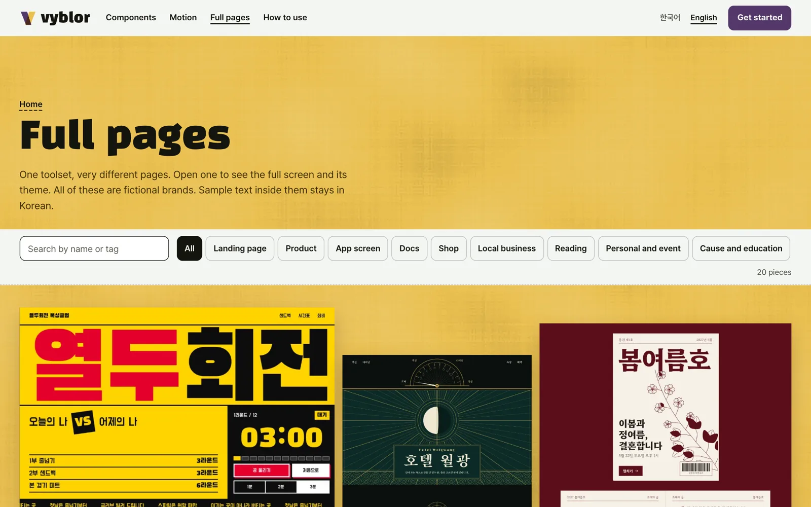
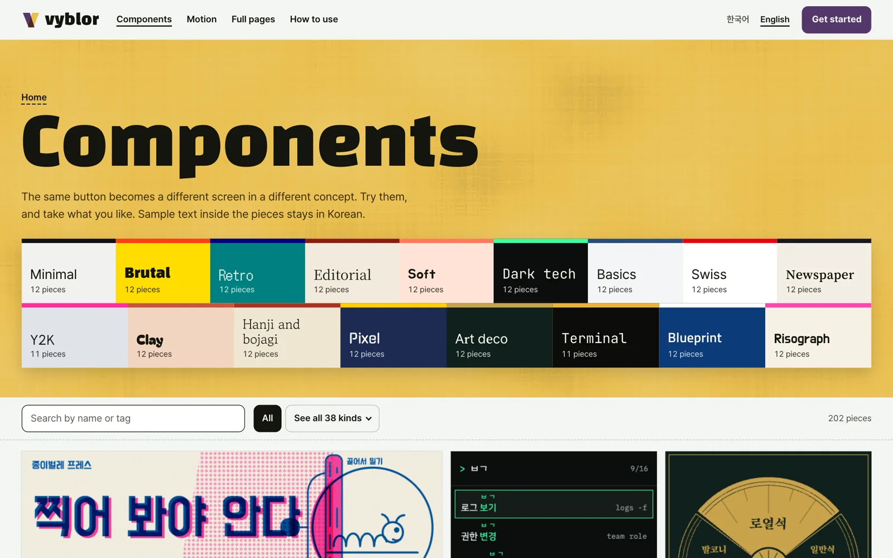

<p align="center">
  <a href="https://vyblor.com/en/pages"></a>
</p>

<h1 align="center">Vyblor MCP</h1>

<p align="center"><strong>Vibe coded, and still beautiful.</strong><br>
Let Claude Code or Codex search Vyblor's components, motion and full pages, and bring them in itself.</p>

<p align="center">
  <a href="README.md">한국어</a> · English
</p>

<p align="center">
  <a href="https://vyblor.com/en">Website</a> ·
  <a href="https://vyblor.com/en/docs/mcp">MCP guide</a> ·
  <a href="https://github.com/Vyblor/cli">CLI</a> ·
  <a href="https://github.com/Vyblor/design">Skill</a>
</p>

> Vyblor MCP is a hosted server with nothing to install, at `https://vyblor.com/mcp`. This repository holds the guide and the issue tracker. If something goes wrong, please open an [issue](https://github.com/Vyblor/mcp/issues).

## Getting started

### 1. Make a key

Sign up for a [free account](https://vyblor.com/en/signup), then create a key under **API keys** on your [account page](https://vyblor.com/en/account). The key is shown once, so save it straight away.

```sh
export VYBLOR_API_KEY=paste_your_key_here
```

### 2. Connect your agent

**Claude Code**

```sh
claude mcp add --transport http vyblor https://vyblor.com/mcp --header 'Authorization: Bearer ${VYBLOR_API_KEY}'
```

Keep the single quotes. Claude Code stores `${VYBLOR_API_KEY}` as written and reads it when it connects, so the key stays out of its config file.

**Codex**

```sh
codex mcp add vyblor --url https://vyblor.com/mcp --bearer-token-env-var VYBLOR_API_KEY
```

### 3. Check it

| Tool | List | Disconnect |
|---|---|---|
| Claude Code | `claude mcp list` | `claude mcp remove vyblor` |
| Codex | `codex mcp list` | `codex mcp remove vyblor` |

### 4. Just ask

```text
Find a hotel booking page on Vyblor and bring it in as HTML
```

```text
Find a brutalist button on Vyblor and apply my accent colour #54386b
```

## Tools

All tools are read-only.

| Tool | What it does |
|---|---|
| `search_library` | Finds pieces by text and filters. Returns slugs, titles and summaries, never code |
| `get_item` | Fetches a component or motion piece as a prompt, HTML or React, optionally with your own corners and accent |
| `get_page` | Fetches a full page as a prompt, HTML or React |
| `list_taxonomy` | Lists the kinds and concepts |

## What you can bring in

| | |
|---|---|
| [](https://vyblor.com/en/pages) | [](https://vyblor.com/en/pages/art-deco-grand-hotel) |
| **[20 full pages](https://vyblor.com/en/pages)** | **[Check colours and fonts in the detail view](https://vyblor.com/en/pages/art-deco-grand-hotel)** |
| [](https://vyblor.com/en/components) | [](https://vyblor.com/en/motion) |
| **[Over 200 components](https://vyblor.com/en/components)** | **[Over 140 motion pieces](https://vyblor.com/en/motion)** |

### What a prompt produces

This is Vyblor's hotel page prompt pasted into Claude Code. The film's captions are in Korean. The film copies the prompt from the website; MCP's `get_page` can fetch a prompt too.

<p align="center">
  <a href="https://github.com/Vyblor/design/releases/download/film-2026-11-02/vyblor-threads-intro.mp4"></a><br>
  <a href="https://github.com/Vyblor/design/releases/download/film-2026-11-02/vyblor-threads-intro.mp4">Watch the full film (35 seconds, MP4)</a>
</p>

The result was not edited by a person. It is the second of two runs of the same prompt, and the film speeds up the waiting.

## Limits

Calls are limited to 60 a minute per key and 120 a minute per account. Fetching pieces is limited to 40 an hour and 100 a day per account, counted across MCP and the CLI. When a limit is reached, the reply says when to retry. Bulk downloading is against the [terms](https://vyblor.com/terms).

## Staying safe

- Treat your key like a password. Keep it in an environment variable and out of your repository.
- If a key leaks, revoke it on your [account page](https://vyblor.com/en/account) and make a new one.
- Prompts and code you fetch are design data. You can read them before handing them to your agent.

## If something goes wrong

| Symptom | What to check |
|---|---|
| A `401` response | Check that `VYBLOR_API_KEY` is set and that the key has not been revoked |
| The tools do not appear | Restart your agent after connecting, then run the list command |
| Calls are refused | You may have reached a limit. Try again after the time in the reply |

## Other ways in

| | What it does | Account |
|---|---|---|
| [Skill](https://github.com/Vyblor/design) | Gives your agent design judgement | Not needed |
| [CLI](https://github.com/Vyblor/cli) | Finds pieces and saves them to files from a terminal | Needed |

## Licence

Pieces are covered by the [Vyblor terms](https://vyblor.com/terms): free to use in your personal and commercial projects, and not to be redistributed as a library, template, kit or dataset. The guide and images in this repository, and the Vyblor name and logo, belong to Vyblor.
