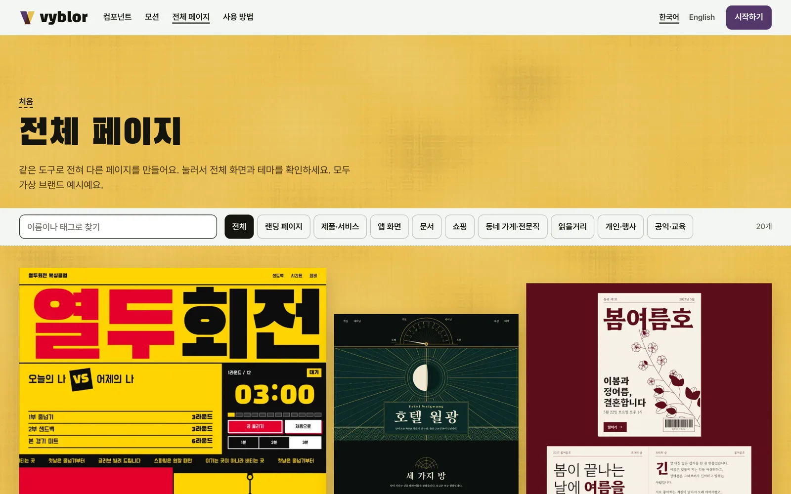
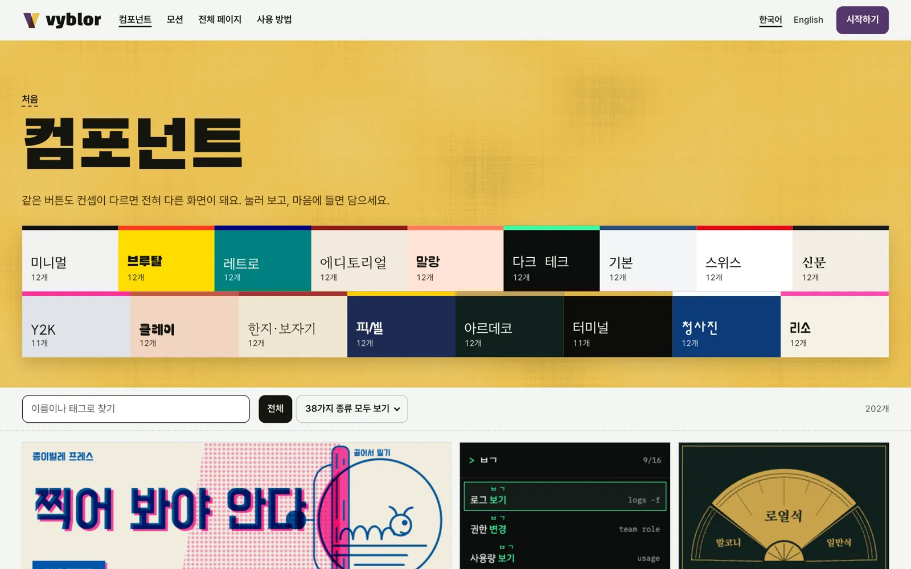

<p align="center">
  <a href="https://vyblor.com/pages"></a>
</p>

<h1 align="center">Vyblor MCP</h1>

<p align="center"><strong>바이브 코딩으로도, 예쁘게.</strong><br>
Claude Code나 Codex가 Vyblor의 컴포넌트, 모션, 전체 페이지를 직접 찾아 가져오게 해 줘요.</p>

<p align="center">
  한국어 · <a href="README.en.md">English</a>
</p>

<p align="center">
  <a href="https://vyblor.com">웹사이트</a> ·
  <a href="https://vyblor.com/docs/mcp">MCP 안내</a> ·
  <a href="https://github.com/Vyblor/cli">CLI</a> ·
  <a href="https://github.com/Vyblor/design">스킬</a>
</p>

> Vyblor MCP는 설치 없이 쓰는 원격 서버예요. 주소는 `https://vyblor.com/mcp`이고, 이 저장소는 안내 문서와 문의 창구예요. 문제가 있으면 [Issues](https://github.com/Vyblor/mcp/issues)에 남겨 주세요.

## 시작하기

### 1. 키 만들기

[무료 계정](https://vyblor.com/signup)으로 가입한 뒤 [계정 페이지](https://vyblor.com/account)의 **API 키**에서 키를 만들어요. 키는 만들 때 한 번만 보이니 바로 저장해 주세요.

```sh
export VYBLOR_API_KEY=여기에_키_붙여넣기
```

### 2. 에이전트에 연결하기

**Claude Code**

```sh
claude mcp add --transport http vyblor https://vyblor.com/mcp --header 'Authorization: Bearer ${VYBLOR_API_KEY}'
```

따옴표는 작은따옴표 그대로 써 주세요. Claude Code가 `${VYBLOR_API_KEY}`를 글자 그대로 보관했다가 연결할 때 읽어서, 키가 설정 파일에 남지 않아요.

**Codex**

```sh
codex mcp add vyblor --url https://vyblor.com/mcp --bearer-token-env-var VYBLOR_API_KEY
```

### 3. 확인하기

| 도구 | 목록 확인 | 연결 해제 |
|---|---|---|
| Claude Code | `claude mcp list` | `claude mcp remove vyblor` |
| Codex | `codex mcp list` | `codex mcp remove vyblor` |

### 4. 말로 시키기

```text
Vyblor에서 호텔 예약 페이지를 찾아서 HTML로 가져와 줘
```

```text
Vyblor에서 브루탈 컨셉의 버튼을 찾아서 내 강조 색 #54386b로 적용해 줘
```

## 제공하는 도구

모두 읽기 전용이에요.

| 도구 | 하는 일 |
|---|---|
| `search_library` | 글자와 조건으로 조각을 찾아요. 코드 없이 slug, 제목, 요약만 돌려줘요 |
| `get_item` | 컴포넌트나 모션을 프롬프트, HTML, React로 가져와요. 내 모서리와 강조 색도 입힐 수 있어요 |
| `get_page` | 전체 페이지를 프롬프트, HTML, React로 가져와요 |
| `list_taxonomy` | 어떤 종류와 컨셉이 있는지 알려 줘요 |

## 어떤 걸 가져올 수 있나요

| | |
|---|---|
| [](https://vyblor.com/pages) | [](https://vyblor.com/pages/art-deco-grand-hotel) |
| **[전체 페이지 20개](https://vyblor.com/pages)** | **[상세 화면에서 색과 글꼴까지 확인](https://vyblor.com/pages/art-deco-grand-hotel)** |
| [](https://vyblor.com/components) | [](https://vyblor.com/motion) |
| **[컴포넌트 200개 이상](https://vyblor.com/components)** | **[모션 140개 이상](https://vyblor.com/motion)** |

### 프롬프트로 만든 결과

Vyblor의 호텔 페이지 프롬프트를 Claude Code에 붙여 넣은 과정이에요. 영상에서는 웹사이트에서 복사했고, MCP의 `get_page`로도 프롬프트를 받을 수 있어요.

<p align="center">
  <a href="https://github.com/Vyblor/design/releases/download/film-2026-11-02/vyblor-threads-intro.mp4"></a><br>
  <a href="https://github.com/Vyblor/design/releases/download/film-2026-11-02/vyblor-threads-intro.mp4">전체 영상 보기 (35초, MP4)</a>
</p>

결과는 사람이 고치지 않았어요. 같은 프롬프트로 두 번 실행한 것 중 두 번째 결과이고, 기다리는 구간은 빠르게 재생했어요.

## 호출 한도

호출은 키마다 1분에 60번, 계정마다 1분에 120번까지예요. 조각을 가져오는 것은 계정마다 한 시간에 40번, 하루에 100번까지이고 MCP와 CLI를 합쳐서 세요. 한도에 닿으면 언제 다시 하면 되는지 알려 줘요. 대량으로 내려받는 것은 [이용약관](https://vyblor.com/terms)에서 금지하고 있어요.

## 안전하게 쓰기

- 키는 비밀번호처럼 다뤄 주세요. 저장소에 올리지 말고 환경 변수로 쓰세요.
- 키가 노출됐다면 [계정 페이지](https://vyblor.com/account)에서 폐기하고 새로 만드세요.
- 가져온 프롬프트와 코드는 디자인 자료예요. 에이전트에게 주기 전에 내용을 확인할 수 있어요.

## 문제가 생기면

| 증상 | 확인할 것 |
|---|---|
| `401` 응답 | `VYBLOR_API_KEY`가 설정됐는지, 키가 폐기되지 않았는지 확인해 주세요 |
| 도구가 안 보여요 | 연결한 뒤 에이전트를 다시 시작하고 목록 명령으로 확인해 주세요 |
| 호출이 거부돼요 | 한도에 닿았을 수 있어요. 응답에 나온 시간 뒤에 다시 해 주세요 |

## 다른 연결 방법

| | 하는 일 | 계정 |
|---|---|---|
| [스킬](https://github.com/Vyblor/design) | 에이전트에게 디자인 판단을 알려 줘요 | 필요 없어요 |
| [CLI](https://github.com/Vyblor/cli) | 터미널에서 찾아 파일로 저장해요 | 필요해요 |

## 라이선스

조각은 [Vyblor 이용약관](https://vyblor.com/terms)을 따라요. 개인 작업과 상업 작업에 자유롭게 쓸 수 있고, 라이브러리, 템플릿, 키트, 데이터셋으로 재배포할 수는 없어요. 이 저장소의 안내 글과 이미지, Vyblor 이름과 로고는 Vyblor의 것이에요.
